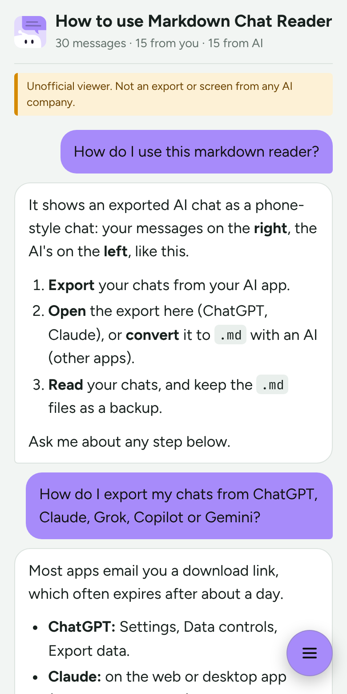
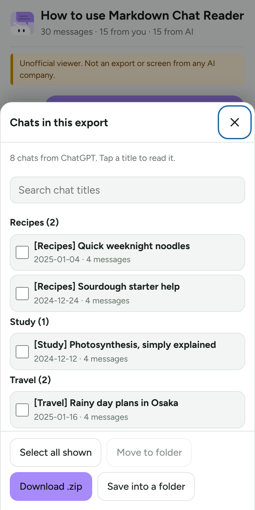
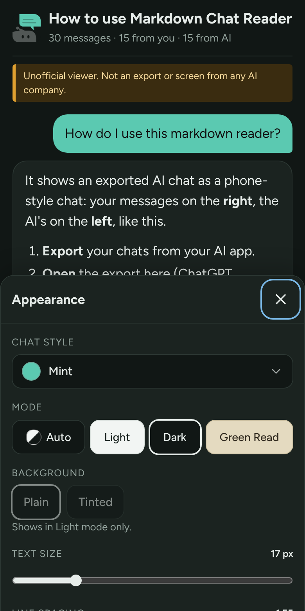

<p align="center"></p>

# Markdown Chat Reader

Read your exported AI chats as a phone-style chat, keep them sorted in folders, and back them up as plain Markdown files. It runs in your browser, works offline, and installs on your phone like an app.

**Live site:** https://sarail19th.github.io/markdown-chat-reader/

<p align="center">
  
  
  
</p>

## Why this exists

I wanted a backup of my ChatGPT chats that I could read on Google Drive. The export turned out to be one huge file: every chat from every project mixed together by date, with no project names. Asking another AI to sort it out meant uploading all my chats, running into free-plan limits, and hoping nothing got shortened along the way.

So I made this. It opens the export on my own phone, lets me put chats back into folders, and saves them as `.md` files that Google Drive shows as plain text and this app shows as a chat. Nothing leaves the device.

I built it with help from Claude (Claude Code), and I test each change on my own phone.

## How it works

1. **Export** your chats from ChatGPT, Claude or another AI app (Help in the app lists the steps).
2. **Open the export here** (ChatGPT and Claude). Tap a chat to read it, use **Move to folder** to sort chats into projects (titles that start with `[Name]` go into the folder Name), and **Download .zip** for one `.md` file per chat, in folders. For other apps, Help has a prompt that asks an AI to do the conversion.
3. **Read any time.** Open a `.md` file, or the backup `.zip` to get its list back.

## Your chats stay with you

- Files and exports are read inside your browser. Nothing is uploaded, and there is no server that could receive them.
- Chats are never saved. Only display choices are remembered on your device, plus chat ID codes and folder names if you turn on **Remember my folders** (turning it off, or Reset all settings, forgets them).
- The app's own files are cached so it works offline. Your chats never are.

## Features

- Detects speakers in many Markdown formats, including custom names.
- Classic, White and seven soft colours, Auto, Light, Dark and Green Read modes, an optional tinted background, text size, spacing and font settings.
- Search, previous and next message, jump to start or end, and a drag handle for long chats on touch screens.
- Edit: fix text and formatting, swap or split speakers, delete messages, split a long chat into two files or save an excerpt. Your original file never changes, and saved copies say they were edited.
- Export converter for ChatGPT and Claude: follows the version of each chat you last saw, leaves out hidden thinking, and keeps every message word for word. Converted files re-open exactly, even when a story contains dialogue such as `**Name:**`.
- Installs as an app (PWA). On Android, **Share** a `.md` file or an export to it.

Edited chats are labelled, and the page always shows that it is an unofficial viewer, not a screen from any AI company. Please only edit your own chats.

## Run it locally

No build step. Serve the folder with any static server, for example:

```bash
python3 -m http.server 8000
```

Then open `http://localhost:8000`. Service workers need `localhost` or HTTPS.

## Tests

GitHub runs them on every push (see the **Actions** tab); the site only deploys when they pass. To run them on a computer with Node.js:

```bash
npm install
npx playwright install chromium   # once, the browser the tests drive
npm test
```

`tests/parser.test.js` checks how `.md` text is split into messages. `tests/app.test.js` opens the app in an invisible Chrome and uses the made-up files in `tests/fixtures` (rebuild them with `python3 tests/fixtures/make.py`).

## Files

| Path | What it is |
|---|---|
| `LICENSE` | MIT licence for this app's own code |
| `index.html` | The app: HTML, CSS and vanilla JavaScript. The parser sits between the `//#parser-start` and `//#parser-end` markers. |
| `sample.md` | The sample chat shown on first load. It explains how to use the reader, in the reader's own chat format. Edit it to change the start screen. |
| `sw.js` | Service worker for offline use. It caches only app files, never chats. |
| `manifest.webmanifest`, `icon-192.png`, `icon-512.png`, `icon-maskable-512.png`, `apple-touch-icon.png` | Install-as-app support (`icon-source.svg` is the editable source of the icon, not deployed) |
| `vendor/` | [marked](https://github.com/markedjs/marked) and [DOMPurify](https://github.com/cure53/DOMPurify), bundled so the app works offline |
| `fonts/` | Figtree and JetBrains Mono (woff2) with their SIL Open Font Licence files |
| `.github/workflows/pages.yml` | Runs the tests on every push, and deploys to GitHub Pages from `main` when they pass |
| `tests/`, `package.json` | Automated tests (see below); `tests/fixtures` holds made-up exports, never real chats |
| `.github/screenshots/`, `.github/social-preview.png` | README screenshots (made with sample data) and the repository's social preview image |

## Licence

MIT, see [LICENSE](LICENSE). Bundled libraries and fonts keep their own licences. The font licences are in `fonts/`. See the marked and DOMPurify projects for theirs.
